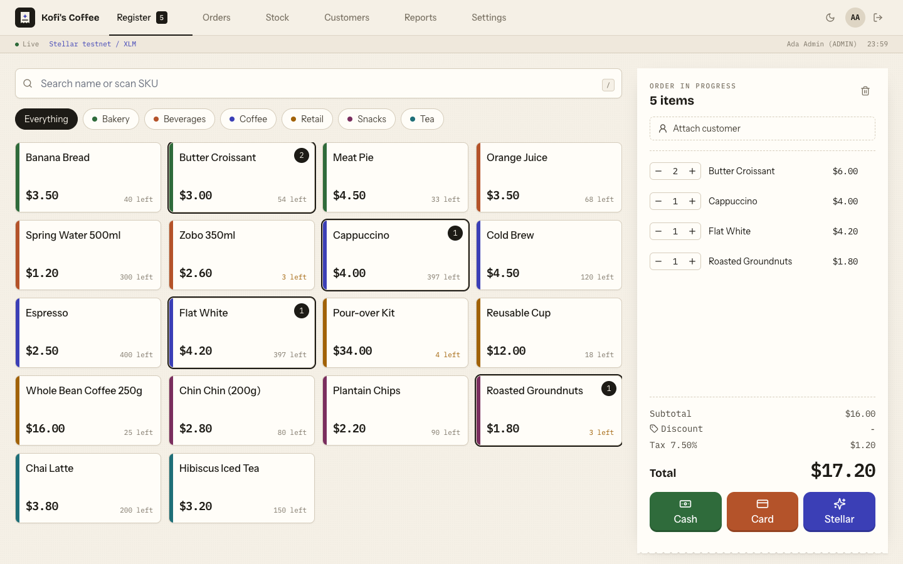
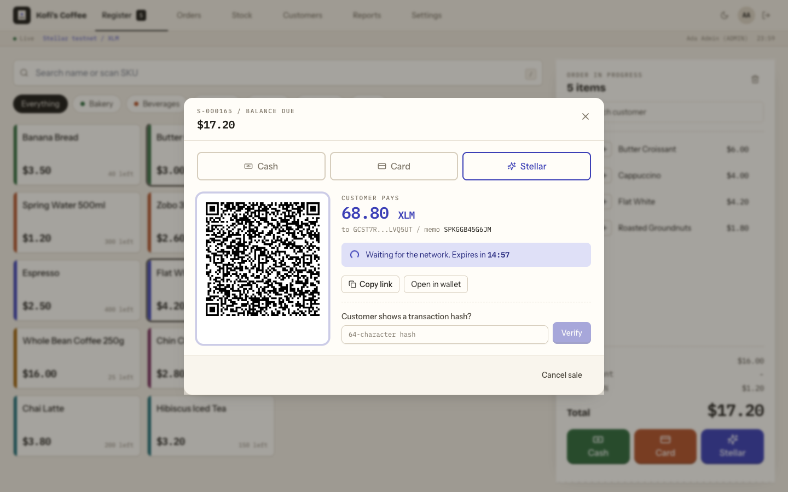
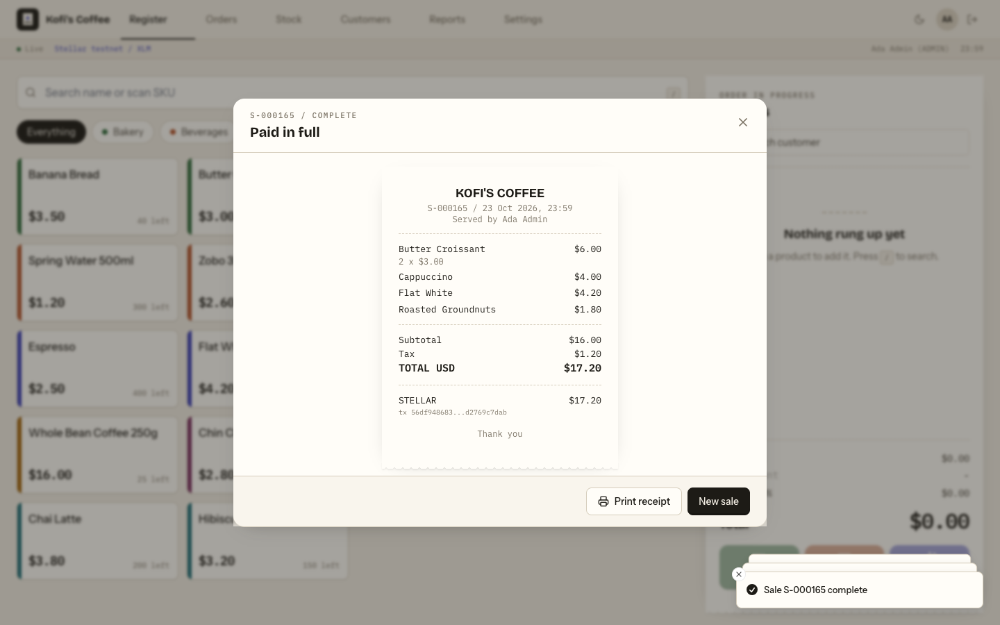
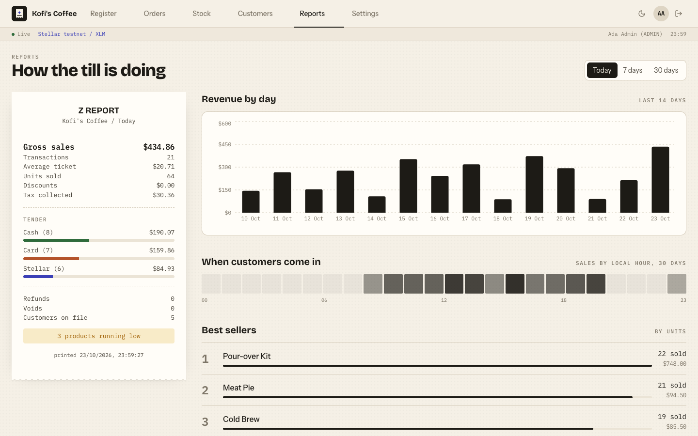
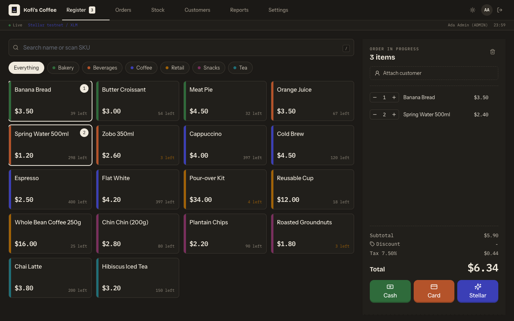
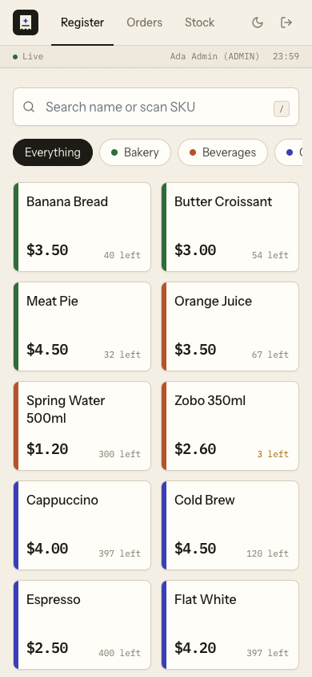

# StellarPOS Surface

The point-of-sale app cashiers and managers use: ring up sales, take cash,
card or **Stellar QR** payments, and run the shop's stock, customers and
end-of-day reports.

[](https://github.com/StellarPOS-App/surface/actions/workflows/ci.yml)




| Repository | What it is |
|---|---|
| [`surface`](https://github.com/StellarPOS-App/surface) (this repo) | The point-of-sale web app |
| [`backend`](https://github.com/StellarPOS-App/backend) | REST + WebSocket API, Stellar payment watcher |
| [`contracts`](https://github.com/StellarPOS-App/contracts) | Soroban contracts: settlement, loyalty, treasury, escrow |

## What it does

**Register.** Product tags color-coded by category, search that doubles as a
barcode-scanner input (scan a SKU and press Enter), and an order panel laid
out like the receipt it will print. Attach a customer, apply a discount, and
see tax computed exactly as the server computes it.

**Three ways to pay, in any mix.** Each method keeps its color everywhere in
the app:

- **Cash**: quick-tender buttons (exact, next note up) and change shown
  before the drawer opens.
- **Card**: confirm the amount your card terminal approved. Charge less than
  the balance to split the bill.
- **Stellar**: a SEP-0007 QR the customer scans with any Stellar wallet. The
  screen waits for the network and flips to *Paid* by itself the moment the
  payment lands. No hash copying, no "did it go through?".

| Stellar QR checkout | Settled on-chain, receipt ready |
|---|---|
|  |  |

**Orders.** Every sale with its printable 80mm receipt, the transaction
hash for Stellar payments, voids for open sales (stock goes back on the
shelf), and manager refunds.

**Stock.** A dense table with inline receive and write-off controls,
low-stock flags, archive instead of delete for anything already sold, and
real-time "running low" alerts.

**Reports.** The day's Z report (gross, tender split, refunds, voids) laid
out the way a till prints it, next to revenue by day, a heat strip of busy
hours, and best sellers.



**And:** customer history and lifetime spend, staff and role management,
live merchant wallet balances, keyboard shortcuts (keys `1` to `6` switch
modes, `/` searches), a "night shift" dark theme, and a layout that works on
a tablet or phone.

| Night shift | Phone |
|---|---|
|  |  |

## Getting started

### Prerequisites

| Tool | Minimum version | Notes |
|---|---|---|
| **Node.js** | 20 LTS | Check with `node -v`. [nvm](https://github.com/nvm-sh/nvm) or [fnm](https://github.com/Schniz/fnm) are recommended for version management |
| **npm** | 9 | Bundled with Node 20. Check with `npm -v` |
| **Git** | any recent | For cloning and branching |

This repository is the **frontend only**. It needs the
[StellarPOS backend](https://github.com/StellarPOS-App/backend) running
locally to serve the API and handle real-time events. Set the backend up
first (takes about a minute), then come back here.

#### 1 — Start the backend

```bash
git clone https://github.com/StellarPOS-App/backend.git
cd backend
npm install
npm run db:seed   # creates the SQLite database and demo data
npm run dev       # listens on http://localhost:3000
```

Leave that terminal open. The backend must stay running while you develop.

#### 2 — Clone and install the frontend

Open a new terminal:

```bash
git clone https://github.com/StellarPOS-App/surface.git
cd surface
npm install
```

#### 3 — Configure environment variables (optional for local dev)

The Vite dev server proxies `/api` and `/socket.io` to `http://localhost:3000`
automatically, so **no `.env.local` is needed for a default local setup**.

If you need to change any defaults — for example to point at a remote backend
or adjust the idle timeout — copy the example file and edit it:

```bash
cp .env.example .env.local
# then open .env.local in your editor
```

See the [Configuration](#configuration) section below for a full variable
reference.

#### 4 — Start the dev server

```bash
npm run dev       # http://localhost:5173
```

Open `http://localhost:5173` in your browser. Sign in with the demo account
created by the backend seed:

| Field | Value |
|---|---|
| Email | `admin@stellarpos.dev` |
| Password | `stellarpos-demo` |

You should land on the POS register. The dashboard, transactions, inventory,
and settings pages are all accessible from the sidebar.

#### 5 — Verify everything works

```bash
npm run check     # lint + type-check + tests (what CI runs)
```

All 35 tests should pass. If any fail, check that your Node version meets the
minimum (`node -v` → 20+) and that dependencies are installed (`npm install`).

### Trying Stellar QR checkout

The register's QR checkout requires a Stellar account. To test it end to end:

1. Create a funded **testnet** account at [laboratory.stellar.org](https://laboratory.stellar.org) or with the Stellar CLI.
2. On the **backend**, set `STELLAR_MERCHANT_PUBLIC_KEY` to that account's public key (G…).
3. Restart the backend.
4. On the register, add items to the cart and select **Stellar QR** as the payment method.
5. Scan the QR with any testnet-capable Stellar wallet (e.g. [LOBSTR](https://lobstr.co) on testnet mode).

No real funds are involved on testnet.

### Common first-run problems

**`ERR_CONNECTION_REFUSED` on API calls**
The backend is not running or is not on port 3000. Start it (`npm run dev` in the backend directory) and confirm it logs `Listening on :3000`.

**Blank page or `404` on hard refresh**
Only happens in production builds. The dev server handles SPA routing correctly. For production, the included `nginx` config (via Docker) or `netlify.toml` handles it.

**Type errors during `npm run dev`**
Run `npm install` to ensure all packages are present, then check that your Node version is ≥ 20.

**`VITE_API_BASE_URL` not taking effect**
Vite only reads `.env.local` at startup. Restart the dev server after changing any `.env.local` value.

### Configuration

Copy [`.env.example`](.env.example) to `.env.local` and edit the values for
your environment. Variables prefixed with `VITE_` are bundled into the browser
build by Vite — do not put secrets in them.

| Variable | Default | Purpose |
|---|---|---|
| `VITE_API_BASE_URL` | `/api/v1` | API base path, or an absolute URL when the API is on a different origin |
| `VITE_SOCKET_URL` | same origin | Socket.IO server origin; empty = same origin (works with the dev proxy) |
| `VITE_IDLE_TIMEOUT_MINUTES` | `30` | Minutes without input before an unattended till is signed out; a warning fires 5 minutes before. Set to `0` to disable |
| `VITE_DEV_API_TARGET` | `http://localhost:3000` | Target `npm run dev` proxies `/api` and `/socket.io` to (dev only) |

### Docker

```bash
docker build -t stellarpos-surface .
docker run -p 8080:80 -e API_UPSTREAM=http://host.docker.internal:3000 stellarpos-surface
```

nginx serves the build with SPA routing and long-lived caching for hashed
assets, and proxies `/api` and `/socket.io` (with WebSocket upgrade) to
`API_UPSTREAM`.

### Netlify

The repository includes a [`netlify.toml`](netlify.toml), so connecting
**this repository** (`StellarPOS-App/surface`, branch `main`) needs no build
settings in the dashboard. Netlify builds with Node 22, publishes `dist/`, and
serves the app for every route.

The API cannot run on Netlify (it is a long-running server with
WebSockets). Host the [backend](https://github.com/StellarPOS-App/backend)
elsewhere, then in Netlify go to *Site configuration > Environment
variables* and set:

| Variable | Value |
|---|---|
| `VITE_API_BASE_URL` | `https://<your-api-host>/api/v1` |
| `VITE_SOCKET_URL` | `https://<your-api-host>` |

Finally, set `CLIENT_URL` on the backend to your Netlify URL so its CORS
settings allow the app.

If a build fails with TypeScript printing its full option list, Netlify is
building an outdated fork that predates the TypeScript config. Point the
site at this repository, or sync the fork.

## Scripts

| Command | What it does |
|---|---|
| `npm run dev` | Vite dev server with API proxy |
| `npm run build` | Type-check and build to `dist/` |
| `npm test` | Vitest + Testing Library (35 tests) |
| `npm run check` | Lint, type-check, test: what CI runs |

> **Tip for new contributors:** `npm run check` is the single command to run before opening a PR. It runs ESLint, TypeScript, and all tests in sequence — the same gates that CI enforces.

## How it is built

- **React 18 + TypeScript + Vite**, styled with **Tailwind** on a small token
  system (`src/styles/globals.css`): paper and ink surfaces with one hue per
  payment method. Type is Bricolage Grotesque, Instrument Sans and IBM Plex
  Mono, with tabular figures for every amount.
- **TanStack Query** for server state, with one hooks module
  (`src/hooks/queries.ts`) covering every endpoint. Mutations invalidate
  exactly what a sale touches: orders, stock, reports, customers.
- **Zustand** for the session (persisted), the cart, and the theme.
- **Socket.IO** (`src/hooks/useRealtime.ts`) turns server events into cache
  updates and toasts, so every terminal in the shop stays in sync.
- **react-hook-form + zod** for forms; validation messages are written for
  cashiers, not developers.
- **Money is never a float.** Prices are integer cents end to end, and the
  cart uses the same rounding as the server.

```
src/
  components/
    layout/      register shell (mode bar + status strip), auth layout
    pos/         product tags, receipt cart, checkout, Stellar QR, receipt
    ui/          buttons, fields, modal/drawer, badges, money
  hooks/         queries, realtime, auth, hotkeys, countdown
  lib/           API client, POS helpers
  pages/         register, orders, stock, customers, reports, settings, auth
  stores/        session, cart, theme
  utils/         formatting and parsing
```

## Turrets escrow

For high-value transactions StellarPOS can hold funds in a **Stellar Turrets**
trustless escrow contract until both the customer and merchant co-sign the
release. Escrow is **off by default** and activates only when a transaction
exceeds the configurable `VITE_ESCROW_THRESHOLD_XLM` and a Turret endpoint is
set.

See [docs/turrets-escrow.md](docs/turrets-escrow.md) for the full setup guide,
the escrow flow in the UI, the security model, and testnet instructions.

## PWA

StellarPOS is installable as a Progressive Web App. See
[docs/pwa.md](docs/pwa.md) for installation steps, offline behaviour, and
platform-specific limitations (iOS, Android, desktop browsers).

## Merchant guide

See [docs/merchant-guide.md](docs/merchant-guide.md) for a full user guide
covering the dashboard analytics, transaction management (refunds, voids, CSV
export), inventory and product setup, store settings, and role permissions.

## Contributing

See [CONTRIBUTING.md](CONTRIBUTING.md). Report security issues privately,
as described in [SECURITY.md](SECURITY.md).

## License

[MIT](LICENSE)
